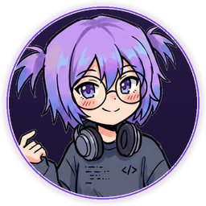
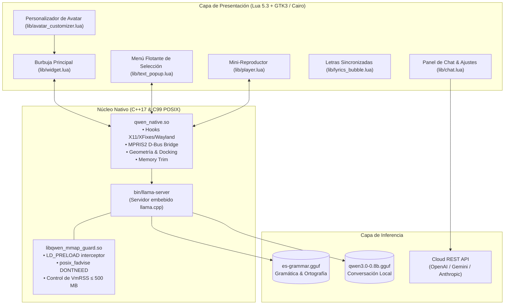

<div align="center">

# Kitsu — Desktop AI Companion & Media Suite

**Widget de escritorio híbrido ultraligero con IA local y en la nube, corrector gramatical instantáneo, mini-reproductor con letras sincronizadas y arquitectura de alto rendimiento.**

[](#instalación-y-compilación-rápida)
[](#arquitectura-híbrida)
[](#arquitectura-híbrida)
[](#sistema-de-diseño)
[](#motor-de-inferencia)
[](LICENSE)

<br/>



<p><em>Kitsu: Burbuja interactiva flotante con diseño vectorial geométrico de alto contraste (política estricta de cero emojis), sprites de estado reactivos en tiempo real y consumo de memoria residente menor a 250 MB con inferencia local activa.</em></p>

</div>

---

## Características Principales

| Módulo | Descripción | Tecnología |
| :--- | :--- | :--- |
| **Burbuja Flotante Reactiva** | Widget circular de escritorio con acoplamiento magnético a los bordes, arrastre fluido y microanimaciones vectoriales. | Lua 5.3 + Cairo + GTK3 |
| **Inferencia Local $\le 500\text{ MB}$** | Servidor `llama.cpp` embebido con cuantización KV $q4\_0$ y desahucio periódico de caché POSIX (`mmap guard`). | C++17 + C99 POSIX |
| **Soporte Cloud Multi-Proveedor** | Conmutación instantánea a OpenAI, Google Gemini, Anthropic o OpenRouter con cifrado seguro local (`0600`). | REST API + libcurl / cURL |
| **Corrector Gramatical al Vuelo** | Menú contextual que aparece inmediatamente al soltar el ratón tras seleccionar texto en cualquier app. | X11 `XFixes` / Wayland hooks |
| **Mini-Reproductor & Letras LRC** | Control integrado para Spotify y YouTube Music con seguimiento de letras karaoke en vivo vía LRCLIB. | D-Bus MPRIS2 IPC |
| **Personalización de Avatar** | Módulo nativo para cargar cualquier imagen del usuario, recortarla al centro (1:1) y ajustarla al widget. | `lib/avatar_customizer.lua` |
| **Agente Asíncrono OpenClaw** | Ejecución en segundo plano de herramientas de sistema, capturas de pantalla, shell seguro y búsqueda web. | Gateway IPC + ReAct Engine |

---

## Arquitectura Híbrida

El sistema desacopla las operaciones de alta frecuencia en capas nativas compiladas en C++ y C99, mientras que la interfaz gráfica y la lógica reactiva se coordinan en Lua:



---

## Instalación y Compilación Rápida

<details open>
<summary><b>Linux (Pop!_OS / Ubuntu / Debian / Arch)</b></summary>

### 1. Dependencias del Sistema
```bash
# En Ubuntu / Debian / Pop!_OS:
sudo apt-get update && sudo apt-get install -y \
    build-essential cmake pkg-config g++ gcc make \
    libglib2.0-dev libx11-dev libxfixes-dev libxi-dev \
    lua5.3 liblua5.3-dev lua-lgi \
    gir1.2-gtk-3.0 gir1.2-gdkpixbuf-2.0 gir1.2-pango-1.0 \
    curl python3 python3-pil

# En Arch Linux / Manjaro:
sudo pacman -Syu --needed base-devel cmake gcc pkgconf lua53 lua53-lgi gtk3 glib2 libx11 libxfixes libxi curl python-pillow
```

### 2. Compilar Módulos Nativos
```bash
cmake -S . -B build -DCMAKE_BUILD_TYPE=Release
cmake --build build -j$(nproc)
```

### 3. Instalar y Ejecutar
```bash
# Descarga automáticamente modelos locales GGUF si no están presentes:
./install.sh
./run.sh
```

*(Opcional) Para construir paquetes redistribuibles `.deb` y `.tar.gz`:*
```bash
./scripts/build_packages.sh
```
</details>

<details>
<summary><b>Windows (MSYS2 / MinGW-w64)</b></summary>

1. Instala MSYS2 o Visual Studio Build Tools 2022 con soporte CMake.
2. Compila la capa nativa:
```powershell
cmake -S . -B build -DCMAKE_BUILD_TYPE=Release
cmake --build build --config Release
```
3. Genera el instalador `.exe` autónomo con NSIS:
```powershell
makensis packaging/windows/installer.nsi
```
El instalador generado se ubicará en `dist/`.
</details>

<details>
<summary><b>macOS (Apple Silicon & Intel)</b></summary>

1. Instala las dependencias con Homebrew:
```bash
brew install cmake pkg-config lua@5.3 gobject-introspection gtk+3 curl python3
pip3 install pillow
```
2. Compila la capa nativa C++ con integración CoreFoundation:
```bash
cmake -S . -B build -DCMAKE_BUILD_TYPE=Release
cmake --build build -j$(nproc)
```
3. Construye el paquete `.dmg` y `.pkg`:
```bash
./packaging/macos/build_dmg.sh
```
</details>

---

## Personalización del Avatar del Widget

Puedes cambiar la ilustración o foto que muestra la burbuja en cualquier momento. El módulo en Lua `lib/avatar_customizer.lua` recorta automáticamente la imagen al centro en proporción $1:1$ y la redimensiona a $256\times 256$ para que encaje a la perfección:

### Desde la Interfaz Gráfica (GUI)
1. Haz clic en la burbuja para abrir la ventana de Chat.
2. Abre la pestaña de Ajustes (icono de engranaje).
3. En la sección **1. General**, haz clic en **`Cambiar Imagen...`** y selecciona cualquier archivo (`.png`, `.jpg`, `.webp`, `.bmp`).
4. La burbuja y el encabezado se actualizarán en tiempo real. También puedes pulsar **`Restablecer`** para volver al arte original.

### Desde la Terminal (CLI)
```bash
# Recortar, redimensionar y aplicar una imagen personalizada:
./bin/kitsu-avatar /ruta/a/tu_imagen.png

# Restablecer el avatar original predeterminado:
./bin/kitsu-avatar --reset
```

---

## Controles del Widget & Interacción

```text
                     ┌───────────────────────────────────┐
                     │          LETRA EN VIVO            │  <-- Burbuja Superior LRC
                     └─────────────────┬─────────────────┘
                                       │ (Acoplamiento automático)
                                ┌──────┴──────┐
                                │   ( O _ O ) │  <-- Burbuja Flotante (72px)
                                └──────┬──────┘
                                       │
                     ┌─────────────────┴─────────────────┐
                     │  [⏮]  [▶]  [⏭]  VOL ━━━━●─── 72%  │  <-- Mini-Reproductor Docked
                     └───────────────────────────────────┘
```

| Acción | Disparador | Efecto |
| :--- | :--- | :--- |
| **Clic Izquierdo** | Clic simple sobre la burbuja | Abre o cierra el panel de Chat AI y Ajustes. |
| **Arrastrar** | Mantener pulsado botón izquierdo | Desplaza el widget por la pantalla; al soltar, se imanta al borde más cercano. |
| **Clic Central** | Pulsar rueda del ratón | Muestra u oculta el mini-reproductor multimedia. |
| **Doble Clic / Clic Derecho** | Sobre la burbuja | Despliega burbuja informativa con datos en vivo (cripto, clima, telemetría). |
| **Selección de Texto** | Seleccionar texto en cualquier app | Despliega el menú instantáneo con botones para Corregir, Formalizar, Traducir o Explicar. |

---

## Sistema de Diseño (Cero Emojis)

El proyecto implementa una estricta directriz de **cero emojis** en toda la interfaz para lograr una estética profesional, nítida y minimalista:

- **Paleta Obsidian:**
  - Fondo oscuro de alto contraste: `#11131E` / `#0B0D14`
  - Acento principal (Voz / Sistema): Azul cobalto `#618AFA`
  - Acento multimedia: Rosa neón `#EC4899`
  - Acento gramatical: Verde esmeralda `#10B981`
  - Acento de alerta: Rojo coral `#EF4444`
- **Iconografía Vectorial Pura:** Todos los glifos (reproducción, pausa, volumen, cerrar, pines, engranajes) se calculan mediante curvas de Bézier y geometría Cairo en tiempo real.

---

## Documentación Técnica & Contribución

- Consulta [`agents.md`](agents.md) para la guía completa de arquitectura interna, variables de entorno y ciclo de vida de la memoria.
- Consulta [`CONTRIBUTING.md`](CONTRIBUTING.md) para las normas de estilo de código, flujos de Pull Request y pruebas.
- Consulta [`RELEASE_NOTES.md`](RELEASE_NOTES.md) para el historial de versiones y cambios detallados.

---

## Licencia

Distribuido bajo la Licencia **MIT**. Consulta [`LICENSE`](LICENSE) para más información.
